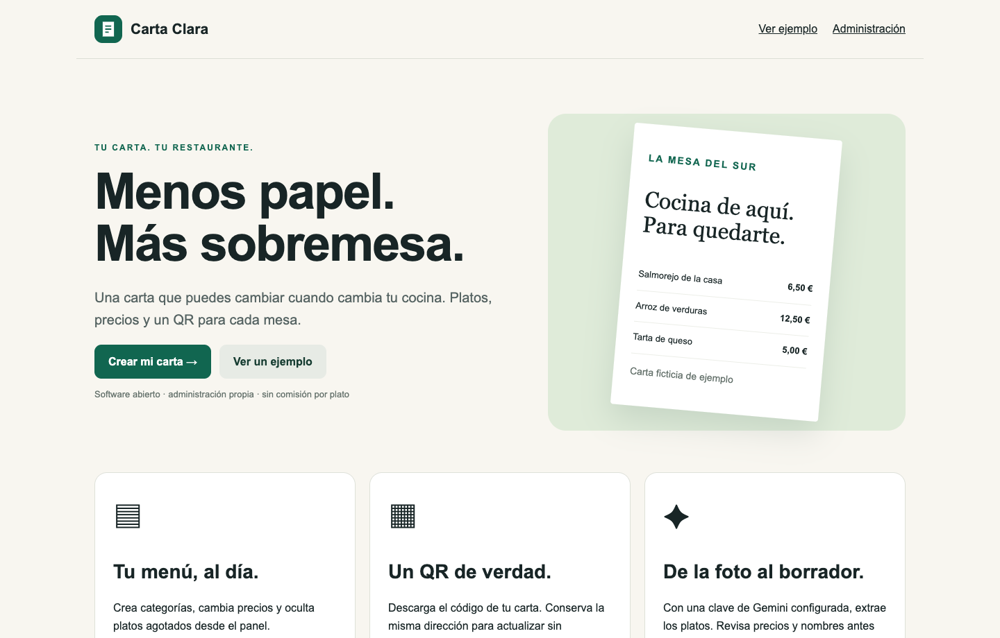

<p align="center"><strong>Carta Clara</strong><br>Menos papel. Más sobremesa.</p>

# Carta Clara

Base de aplicación para cartas digitales: cuentas separadas por restaurante, panel, platos, URL pública, QR y lectura opcional de una foto con Gemini.

[](LICENSE) [](https://github.com/davidcantonnadales/carta-clara/actions/workflows/checks.yml)



## Qué puedes hacer

- Registro y sesiones HTTP-only; cada restaurante administra su propia carta.
- Categorías, descripciones, precios y disponibilidad.
- Identificador único y QR SVG descargable que apunta a la URL real.
- SQLite persistente sin servicios externos para la ruta manual.
- Endpoint de Gemini solo en servidor, imagen validada y limitada; sin exponer la clave.
- La IA produce un borrador. Los precios desconocidos quedan vacíos y exigen revisión antes de guardar.

## Arrancar en tu equipo

Recomendado: **Node.js 22.13 o posterior de la rama 22**, con npm. `.nvmrc` selecciona Node 22. Las pruebas iniciales locales se ejecutaron con Node 23.10.0; CI utiliza Node 22. Las aplicaciones con SQLite usan `node:sqlite`, que puede mostrar un aviso experimental según la versión.

```bash
npm ci
cp .env.example .env.local
```

Para crear cuentas en tu demostración local, cambia `ENABLE_SIGNUP=true`. Ajusta `APP_URL` si cambias el puerto. No necesitas Gemini para usar el editor y el QR.

```bash
npm test
npm run dev
```

Abre **http://127.0.0.1:3000**. Producción local: `npm run build` y `npm start`.

## Una prueba de cinco minutos

Entra en Administración, crea una cuenta local y pulsa Cargar carta de ejemplo. En Restaurante elige un identificador único. Guarda, cambia un precio y oculta un plato; abre la carta pública y descarga su QR.

## Qué incluye esta edición

Esta edición incluye el núcleo de carta y administración por restaurante; no incluye facturación de suscripciones, pagos, mapas externos, traducciones, recuperación de contraseña ni verificación por email. No es un SaaS operativo listo para escalar horizontalmente. SQLite requiere disco persistente y una única instancia de aplicación. Las fotos se envían a Google solo al usar el botón de análisis con una clave propia configurada.

Esta es una edición pública independiente y adaptada para aprender y desarrollar sobre ella. No incluye datos, credenciales, dominios privados ni infraestructura de la instalación de origen. No pretende reproducir todos los módulos de esa instalación.

## Documentación y pruebas

- [Cómo está organizado y cómo configurarlo](docs/CONFIGURACION.md).
- [Pruebas realizadas y límites](docs/PRUEBAS.md).
- [Procedencia de imágenes y capturas](docs/IMAGENES.md).
- [Seguridad y datos](SECURITY.md).


## Contribuir

Abre una issue con los pasos para reproducir el problema, el resultado esperado y la versión de Node/navegador. Para proponer un cambio, crea una rama, comprueba `npm test` y `npm run build`, y abre una pull request. No adjuntes datos personales, documentos de clientes, claves o archivos `.env`.

## Licencia

Código y documentación bajo [MIT](LICENSE). Las ilustraciones de ejemplo, cuando las hay, se generaron con IA para este proyecto y se distribuyen bajo los mismos términos en la medida en que existan derechos aplicables; no se garantiza exclusividad. Las dependencias conservan sus licencias. No se incluyen marcas ni recursos de terceros para sugerir patrocinio.

Creado por [David Cantón](https://davidcanton.net).
